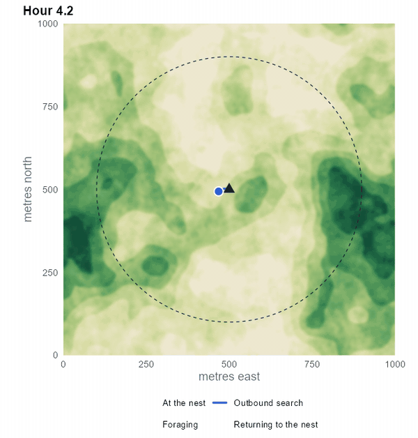
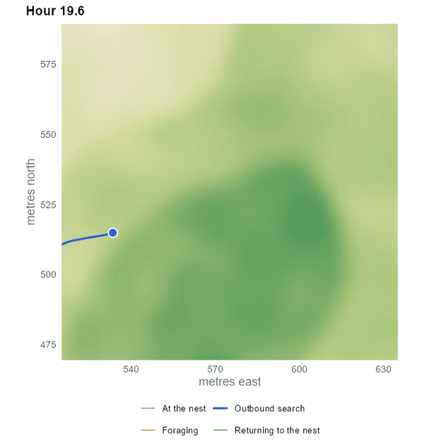

# Hi there, I'm James Owens 👋

### PhD Researcher | Quantitative Ecology | Spatial Ecology 
**School of Biological Sciences @ Queen's University Belfast**

 

---

## 🔭 Current Research Focus

I am testing how well **Geographic Profiling (GP)** can locate the nests of **Central Place Foragers (CPF)**. GP was developed for criminology and is increasingly applied in ecology, but its assumptions were not written with animal movement in mind. My work asks where those assumptions hold, where they break down, and what a model built for ecological processes would need to look like.

To answer that, I build stochastic **simulations of animal movement** where the true nest location is known, generate datasets from them, and apply current GP methods under different movement behaviours, landscapes and sampling designs. In parallel, I am investigating sampling practice, including detection that is imperfect, to inform how future studies should be set up to get the most out of GP.

## 🧬 Featured Project: an explainable movement model for central-place foragers

The simulation is a **step-selection model** of a forager that rests at a nest, travels out, forages where habitat is good, and returns. Every movement decision is generated by the same process that a step-selection analysis assumes, so the parameters can in future be estimated from tracking data.

At each step the animal:

1. **Proposes** 32 candidate moves, with step lengths drawn from a Gamma distribution and turning angles from a von Mises distribution.
2. **Scores** each candidate from habitat quality at its end point and its direction relative to the nest or the last good patch.
3. **Selects** one at random, with probability proportional to `exp(score)`.

Switches between behaviours (starting to forage, leaving a patch, abandoning a trip) are probabilities on each step rather than fixed thresholds, so trips and patch residence times vary between runs.

<table>
<tr>
<td align="center" valign="top">
 
<b>100 hours of one simulated animal.</b> Blue: outbound search. Orange: foraging. Green: returning. The triangle is the nest and the dashed circle is its maximum foraging radius.
</td>
<td align="center" valign="top">
 
<b>From search to area-restricted foraging.</b> Steps shorten and the path becomes more tortuous as the animal enters a high-quality patch, until it resumes travelling.
</td>
</tr>
</table>

 

The model is implemented in **Python** and in **R**, where it comes with an interactive **Shiny** dashboard for exploring how each parameter shapes movement. The dashboard lets you inspect all 32 candidates and their score terms for any single step, and compare trip statistics across parameter values with replicate runs.

<b>📐 See the selection rule (click to expand)</b>

The probability that candidate move *i* is chosen from the *n* candidates at a step is

$$P(i) = \frac{e^{s_i}}{\sum_{j=1}^{n} e^{s_j}}$$

where the score of a candidate is a sum of terms

$$s_i = w\,\beta_H\,H(x_i) + \beta_{out}\cos\theta_{out,i} + \beta_{patch}\cos\theta_{patch,i} + \beta_{home}\cos\theta_{home,i} + \beta_{range}\,\max(0,\,r_i - R)$$

* $H(x_i)$ is habitat quality at the end point of the candidate, with selection strength $\beta_H$ and a behaviour-specific weight $w$.
* The cosine terms reward candidates that point away from the nest, back to the last good patch, or towards the nest. Each is active only in the relevant behaviour.
* The last term penalises steps that end beyond the maximum foraging radius $R$.

Earlier work on how camera-trap placement affects detection of a moving forager is in [cpf_simulation](https://github.com/jamesowensdev/cpf_simulation).

## 🛠️ Technical Stack

* **Languages:** R, Python, Java, SQL, C, Rust (Beginner)
* **Modelling:** Agent-Based Modelling (ABM), Step-Selection Models, Stochastic Simulation, R6 OOP
* **Spatial:** GIS (`terra`, `sf`), Spatial Ecology
* **Tools:** Git, Shiny, Quarto, LaTeX, Docker
